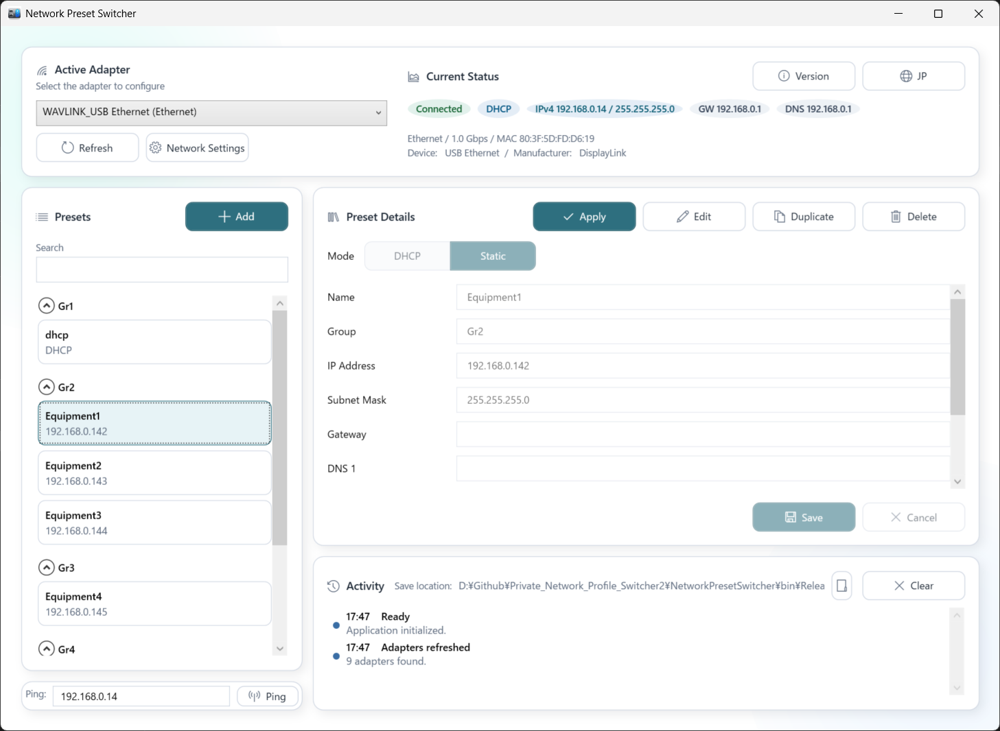

# Network Preset Switcher

[](https://github.com/fa-yoshinobu/Network_Preset_Switcher/releases/latest)
[](https://github.com/fa-yoshinobu/Network_Preset_Switcher/actions/workflows/ci.yml)
[](LICENSE)
[](https://dotnet.microsoft.com/download/dotnet/8.0)


A WPF app for Windows to switch IP settings using presets.

[Changelog (Japanese)](CHANGELOG.md)

## Features
- Switch between DHCP and static IP
- Create, edit, duplicate, delete presets
- Grouping with collapsible sections
- Activity log
- Ping execution
- English / Japanese UI toggle
- Presets saved in CSV (editable in Excel)

## Build
```
build.bat
```

Output:
`artifacts\publish\NetworkPresetSwitcher.exe`

## CI Check
```
ci.bat
```

## CSV Format
Filename: `NetworkPresetSwitcher.csv`
Location: same folder as the exe

Header:
```
Type,Name,Group,IP,Subnet,Gateway,DNS1,DNS2,Comment,Language
```

Settings row:
```
Settings,,,,,,,,,"en-US" or "ja-JP"
```

Preset row:
```
Preset,Name,Group,IP,Subnet,Gateway,DNS1,DNS2,Comment,
```

Notes:
- UTF-8 BOM is recommended. If decoding fails, it falls back to CP932.
- If the header is tab-delimited, it is converted to commas (tabs inside quotes are preserved).
- If the CSV is open in Excel, saving will fail (error is shown).

## UI Notes
- Ping input is initialized with the selected adapter's IPv4 (manual edit is allowed).

## Development
- **Tests**: Unit tests are located in `NetworkPresetSwitcher.Tests` using xUnit.
- **CI**: Automated builds, formatting checks, and tests are run via GitHub Actions.

---

# Network Preset Switcher（日本語）


Windows で IP アドレス設定をプリセットから切り替える WPF アプリです。

[変更履歴](CHANGELOG.md)

## 主な機能
- DHCP / 固定 IP の切り替え
- プリセットの作成・編集・複製・削除
- グループ分け（折りたたみ可能）
- 操作ログの表示
- Ping 実行
- 日本語 / 英語 UI 切り替え
- CSV でプリセット保存（Excel で編集可能）

## ビルド
```
build.bat
```

出力先:
`artifacts\publish\NetworkPresetSwitcher.exe`

## CI チェック
```
ci.bat
```

## CSV 仕様
保存ファイル名: `NetworkPresetSwitcher.csv`
保存場所: exe と同じフォルダ

ヘッダー:
```
Type,Name,Group,IP,Subnet,Gateway,DNS1,DNS2,Comment,Language
```

Settings 行:
```
Settings,,,,,,,,,"en-US" または "ja-JP"
```

Preset 行:
```
Preset,Name,Group,IP,Subnet,Gateway,DNS1,DNS2,Comment,
```

メモ:
- UTF-8 BOM を推奨します。読み込みに失敗した場合は CP932 で再読込します。
- ヘッダーがタブ区切りの場合は自動でカンマに変換します（引用符内のタブは保持）。
- CSV が Excel で開かれている場合は保存できません（エラー表示あり）。

## UI メモ
- Ping 入力欄は選択中アダプタの IPv4 を初期値にします（手動編集も可）。

## 開発情報
- **テスト**: xUnit を使用したユニットテストが `NetworkPresetSwitcher.Tests` にあります。
- **CI**: GitHub Actions により、ビルド、コード整形チェック、テストが自動実行されます。

## Release distribution

The fixed-name ZIP and checksum links below are available for the current release. Older releases retain their original assets.

- [Latest Windows x64 ZIP](https://github.com/fa-yoshinobu/Network_Preset_Switcher/releases/latest/download/NetworkPresetSwitcher-win-x64.zip)
- [ZIP SHA-256 checksum](https://github.com/fa-yoshinobu/Network_Preset_Switcher/releases/latest/download/NetworkPresetSwitcher-win-x64.zip.sha256)
- [Changelog](CHANGELOG.md) / [TODO](TODO.md)

Extract the ZIP file, then run `NetworkPresetSwitcher.exe`.

Windows x64. The .NET runtime is included. Changing network settings may require administrator privileges.

Release notes and VirusTotal scan messages are in English. Existing project documents may keep their current language.

Maintainers: update the English Changes section in `.github/release-notes.md` from the relevant CHANGELOG entries before releasing. The release workflow publishes the ZIP and checksum, then scans the actual published executables. Use the `Scan release with VirusTotal` workflow with a release tag to retry an incomplete scan. See the [shared release standard](https://github.com/fa-yoshinobu/release_standard).
